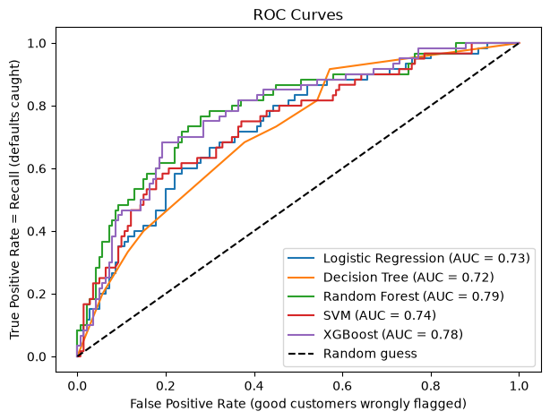
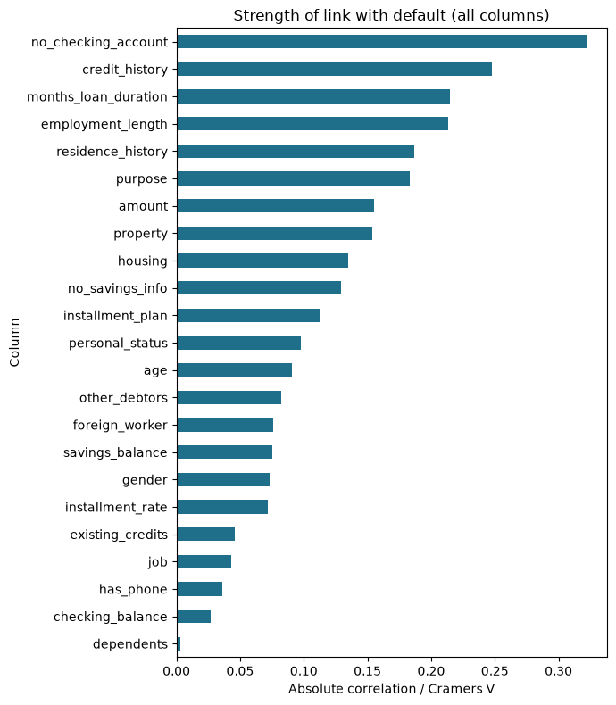
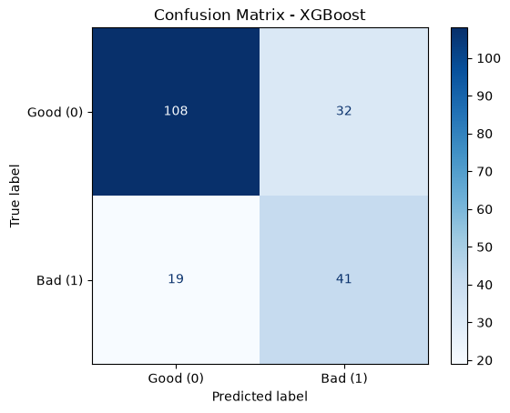

# Credit Risk Prediction & Default Analysis

Predicts whether a loan applicant will **default**, using 1,000 historical credit records. The project compares five tuned classifiers and is evaluated on recall, F1 and ROC-AUC rather than accuracy, because missing a defaulter costs a lender far more than flagging a good customer.



## Approach
1. **Exploration and feature association.** Correlation for numeric features and Cramér's V for categorical features, both measured against `default`.
2. **Preprocessing.**
   - Missing checking and savings balances become 0, plus `no_checking_account` and `no_savings_info` flags.
   - Missing categorical values are filled with `unknown`.
   - Categorical features are one-hot encoded.
   - Low-signal or sensitive columns (gender, personal status, job, dependents, …) are dropped.
3. **Baseline.** LazyPredict screens about 30 classifiers.
4. **Modelling.** Stratified 80/20 split, `StandardScaler` fitted on train only, and `GridSearchCV` tuned on F1. Class imbalance is handled with `class_weight='balanced'` (or `scale_pos_weight` for XGBoost).
5. **Evaluation.** Accuracy, recall, F1 and ROC-AUC, plus ROC curves and a confusion matrix for each model.

## Results (test set)

| Model | Accuracy | Recall | F1 | ROC-AUC |
|---|---|---|---|---|
| Logistic Regression | 0.675 | 0.683 | 0.558 | 0.732 |
| Decision Tree | 0.605 | 0.733 | 0.527 | 0.716 |
| Random Forest | 0.575 | **0.883** | 0.555 | **0.788** |
| SVM (RBF) | 0.665 | 0.683 | 0.550 | 0.741 |
| **XGBoost** | **0.745** | 0.683 | **0.617** | 0.779 |

- **XGBoost** gives the best balance overall (highest accuracy and F1).
- **Random Forest** catches the most defaulters (88% recall), so it suits a lender who wants to minimise missed defaults.

| Feature association with default | XGBoost confusion matrix |
|---|---|
|  |  |

The strongest signals are having no checking account, credit history, loan duration and employment length.

## Repository
| File | Description |
|---|---|
| `credit_risk_prediction.ipynb` | Full analysis and modelling notebook |
| `credit.csv` | Dataset (1,000 rows, 23 columns). The phone column is reduced to a yes/blank flag. |
| `Credit_Risk_Presentation.pptx` | Summary presentation |
| `images/` | Charts exported from the notebook |

## Run it
```bash
pip install -r requirements.txt
jupyter notebook credit_risk_prediction.ipynb
```

## Tech
Python · pandas · NumPy · scikit-learn · XGBoost · LazyPredict · SciPy · Matplotlib · Seaborn

*Built as part of the NAVTTC / NETSOL Institute of AI, AI/ML & Deep Learning program (2026).*
